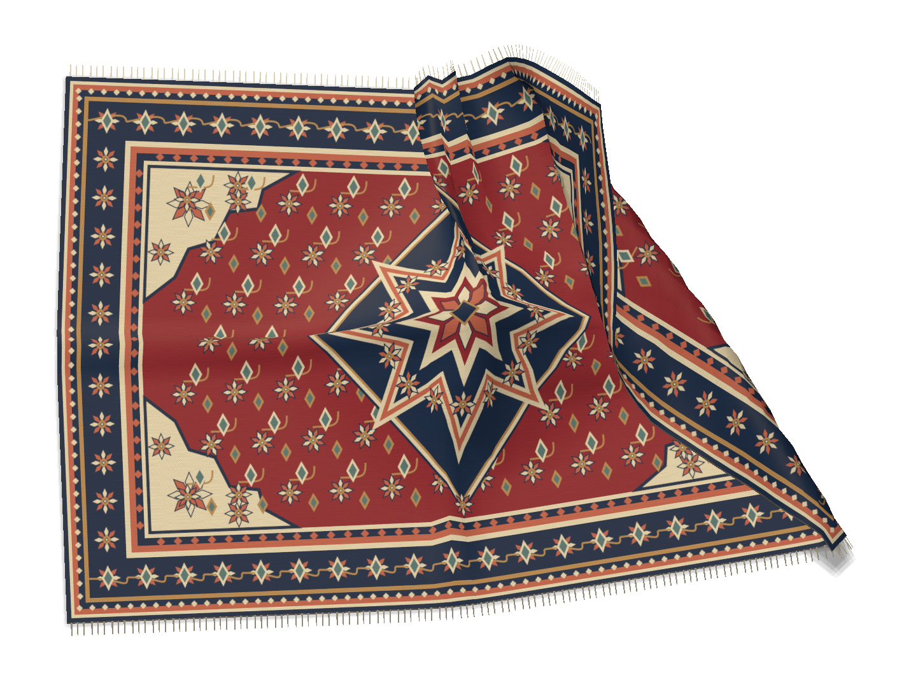
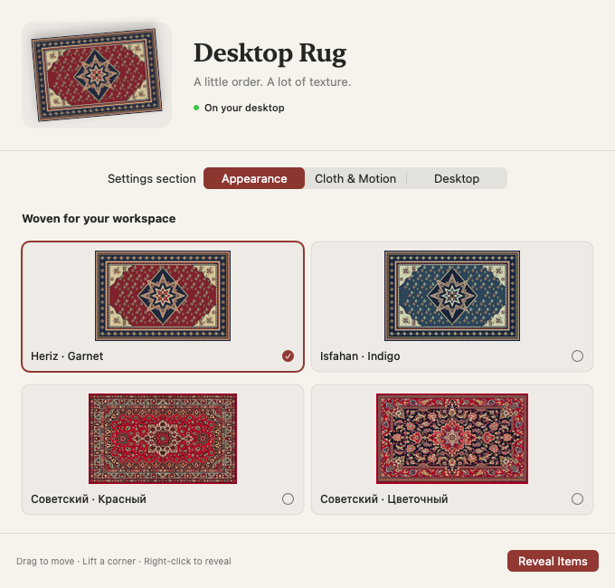

# Desktop Rug

A native macOS desktop rug with interactive cloth physics, woven patterns, and Metal rendering. Lift a corner, fold the fabric, or let it drape over your Finder icons.

[Русский](README.ru.md) · [Download](https://github.com/ShabanovBoris/DesktopRug/releases/latest) · [Contributing](CONTRIBUTING.md) · [MIT license](LICENSE)



## Features

- A transparent desktop panel above Finder icons and below ordinary application windows.
- XPBD cloth simulation with stretching, shear, bending, gravity, friction, damping, and self-collision.
- Metal rendering with material UVs, lighting, contact shadows, edge thickness, and geometric fringe.
- Four rugs: Heriz, Isfahan, Soviet Red, and Soviet Floral.
- Optional Finder integration and manually placed collision mounds.
- Menu bar controls, adjustable size and physics quality, 30/60/120 FPS, and Start at Login.
- Saved settings and position. Physics and drawing pause when the fabric settles.

Swift, AppKit, SwiftUI, and Metal. No third-party runtime dependencies.

## Install

Download the ZIP from [GitHub Releases](https://github.com/ShabanovBoris/DesktopRug/releases/latest), unzip it, and move **Desktop Rug.app** to Applications. Launch the app and look for its icon in the menu bar; it has no Dock icon.

The first release requires **macOS 14 or newer and Apple Silicon**. The release filename includes its architecture. Intel source builds are possible with the build script, but the first release does not include a tested Intel binary.

Release binaries are **ad-hoc signed and not notarized**. macOS may block the first launch. After attempting to open the app, use **System Settings → Privacy & Security → Open Anyway** if you choose to trust this download. See [Apple's instructions](https://support.apple.com/guide/mac-help/open-a-mac-app-from-an-unknown-developer-mh40616/mac). You can also build from source.

Each release includes a `.sha256` file. In the download directory, verify the archive with:

```bash
shasum -a 256 -c DesktopRug-v1.0.0-macOS-arm64.zip.sha256
```

## Controls

| Action | Result |
|---|---|
| Drag the middle | Move the entire rug |
| Drag a corner | Lift and fold the fabric |
| Option-drag | Grab any point on the cloth |
| Shift-click | Add a manual collision mound |
| Right-click / Reveal Desktop Items | Hide the rug and access the original icons |
| Lock Rug | Let mouse input pass through the rug |
| Relax Fabric | Relax the mesh over its current objects |
| Reset Rug Position | Center the rug on its selected display |

Open **Settings → Appearance** to choose a pattern. **Cloth & Motion** controls material and performance; **Desktop** controls the display, Finder connection, manual objects, and login item.



## Finder and privacy

Use **Connect Finder…** to enable automatic icon collisions. macOS asks for Automation access to Finder. The app reads desktop item names, URLs, icon size, and icon positions through Finder's public AppleScript interface. It never moves, edits, or deletes desktop files. Accessibility and Screen Recording permission are not required.

Finder positions are refreshed every two seconds while the rug is shown. Errors stop polling and appear in settings. Automatic icon geometry is supported on the main display with normally positioned icons; Stacks, arrangement modes, and secondary-display positions can be unavailable or stale. Manual mounds remain available.

Desktop Rug has no telemetry or network client. See [Privacy](docs/PRIVACY.md) for settings and diagnostic data.

## Build from source

Requirements: macOS, an Apple Swift compiler with the macOS SDK, and Python 3.9 or newer. The app deployment target is macOS 14. No Python packages are needed.

```bash
git clone https://github.com/ShabanovBoris/DesktopRug.git
cd DesktopRug
python3 scripts/build.py
open "build/Desktop Rug.app"
```

The script builds an optimized application for the current Mac's architecture, bundles all four textures and their license information, and applies an ad-hoc signature with the Apple Events entitlement. The bundled Metal source is compiled by the system at launch when no precompiled library is present.

Alternatively, open **DesktopRug.xcodeproj**, select **DesktopRug**, and run the Release scheme. A complete Xcode installation with its required components is needed for this path:

```bash
xcodebuild -project DesktopRug.xcodeproj -scheme DesktopRug \
  -configuration Release -derivedDataPath build/xcode build
```

The shared version is in `VERSION`. Regenerate the project after changing it or adding source/resources:

```bash
python3 scripts/generate_project.py
```

## Test and package

```bash
bash scripts/test.sh
python3 scripts/package_release.py
```

The test suite contains 14 XCTest cases for geometry, collisions, self-contact, dragging, settling, stability, coordinate conversion, and settings serialization. GitHub Actions runs the tests, builds the app, checks project generation, verifies the signature and archive contents, and uploads a build artifact.

The packaging script verifies the built version, architecture, code signature, executable permission, and every extracted file. It writes a versioned ZIP and SHA-256 file under `build/release/`. Run `scripts/build.py` first.

Native checks require an interactive graphical session. Close the normal app before running them:

```bash
"build/Desktop Rug.app/Contents/MacOS/DesktopRug" --validate "$PWD/build/validation" --deep-fold
"build/Desktop Rug.app/Contents/MacOS/DesktopRug" --validate-ui "$PWD/build/ui-validation"
```

These modes use isolated settings and explicit test geometry. They save the app's own Metal frames and SwiftUI views, rather than desktop screenshots. See [Testing](docs/TESTING.md) for additional checks and their limits.

## Architecture

| Component | Responsibility |
|---|---|
| `DesktopRugApp` | Lifecycle, menu, settings, Finder coordination, diagnostics |
| `DesktopWindowController` | Desktop panel, display selection, visibility, pause/wake |
| `RugInteractionController` | Mesh hit testing, grabbing, movement, mouse passthrough |
| `ClothSimulation` | Fixed 1/120 s XPBD steps, constraints, settling |
| `CollisionSystem` / `ClothSelfCollision` | Floor/mound contact, vertex–triangle and edge–edge self-contact |
| `RugRenderer` | Metal mesh, normals, shadows, edges, fringe, captures |
| `DesktopItemProvider` | Public Finder reads and a separate explicit test provider |
| `SettingsStore` | Configuration ownership and Codable/UserDefaults persistence |

The core physics package is independent of AppKit. The balanced mesh is 41 × 29 particles. Material UVs stay attached to the mesh during deformation. Bending uses distance constraints; self-contact uses spatial hashes and approximate movement checks within each step.

## Limitations

- One rug on one selected display. Switching displays is supported; continuous dragging between displays is not implemented.
- Full coverage of Spaces, Mission Control, Stage Manager, and fullscreen transitions has not been verified.
- Cloth can retain folds after release. Self-collision is approximate and does not guarantee separation under every extreme interaction.
- Icon thickness is modeled, not supplied by Finder. Large overlapping piles are bounded.
- Shadows are approximate. A short local run measured about 60 FPS; performance depends on hardware, mesh quality, and deformation. Extended leak testing has not been completed.
- Startup recalculates the mesh; saved settings and position do not include an existing folded shape.

## Assets and license

The project is released under the [MIT license](LICENSE). Heriz/Isfahan textures and the app icon are generated by `Tools/GenerateRugAssets.swift`. The two Soviet patterns were prepared with imagegen from supplied reference photographs; the [asset provenance and prompts](DesktopRug/Resources/TextureSources.md) are included. Original reference photographs are not part of the repository.

To regenerate procedural graphics:

```bash
swift Tools/GenerateRugAssets.swift DesktopRug/Resources
```

This command preserves the two Soviet textures. Documentation images show only the app's own rendered cloth and settings.
